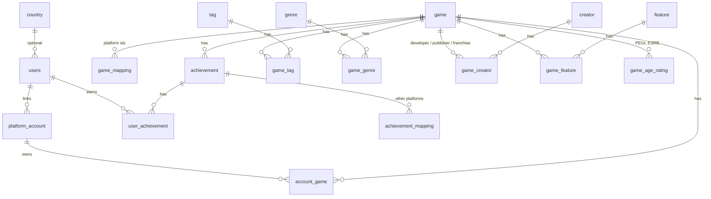

# Achievement Tracker — backend

A Spring Boot backend for an **achievement tracker**: people sign in with Google or e-mail, link their game
platform accounts, and see their games and achievements, with unlock percentages worldwide and per country.
Steam works today; Xbox and PSN are planned.

The catalog of games is built from Steam and kept **safe for work**: adult games are filtered out, so the public
pages can be shown to people who are not logged in.

> This README describes what exists **right now**. The [Roadmap](#roadmap) lists what is next, and the
> [Decisions log](#decisions-log) records choices that are already made. Update both as the project moves.

---

## Contents

1. [Status](#status)
2. [Tech stack](#tech-stack)
3. [Architecture](#architecture)
4. [Getting started](#getting-started)
5. [Configuration](#configuration)
6. [Database](#database)
7. [Authentication and privacy](#authentication-and-privacy)
8. [Steam: linking and syncing](#steam-linking-and-syncing)
9. [The catalog and the content policy](#the-catalog-and-the-content-policy)
10. [API reference](#api-reference)
11. [Postman collection](#postman-collection)
12. [Testing](#testing)
13. [Troubleshooting](#troubleshooting)
14. [Roadmap](#roadmap)
15. [Decisions log](#decisions-log)

---

## Status

| Area | State |
|---|---|
| Sign-in (Firebase ID token verified by the backend) | Working |
| Users: private Google data, random public username, optional country | Working |
| Link a Steam account (Steam OpenID with a signed `state`) | Working |
| Sync a Steam library: games, achievements, unlocks, `lastSyncedAt` | Working |
| Catalog from Steam: tags, genres, developers, publishers, franchises, features, age ratings | Working |
| Safe-for-work content policy (tags with weights, descriptors, ratings) | Working |
| Statistics: global and per-country unlock percentages | Working |
| Admin tools: seed, walk all of Steam, enrich, refresh | Working |
| Search (games, tags, franchises, developers, publishers) | **Designed, not built** |
| Public pages without login, player search, public profiles | **Designed, not built** |
| DTO layer, input validation, OpenAPI docs | **Planned next** |
| Xbox and PSN | Planned |

## Tech stack

- **Java 21+**, **Spring Boot 4.1**, Maven
- **PostgreSQL** on **Supabase**, schema owned by **Flyway**, Hibernate 7 only validates it
- **Firebase Authentication** (the frontend signs in; the backend verifies the ID token with the Admin SDK)
- **Spring Security 7**, stateless, one custom filter
- Steam **Web API** and the Steam store backend, through Spring's `RestClient`
- Tests: JUnit and AssertJ

## Architecture

**Hexagonal (ports and adapters), organised by feature.** Each feature has the same three layers:

```
feature/
├── domain/                     plain Java: no Spring, no JPA
├── application/
│   ├── port/in/                what the feature offers (use cases)
│   ├── port/out/               what the feature needs (repositories, external services)
│   └── service/                implements the in-ports, uses the out-ports
└── adapter/
    ├── in/web/                 REST controllers
    └── out/persistence/        JPA entities, repositories, mappers, JDBC adapters
```

### Features

| Package (`com.lavrel.…`) | Responsibility |
|---|---|
| `user` | Users, countries, usernames, linked platform accounts, Firebase and Steam identity |
| `catalog` | Games, achievements, mappings, tags, genres, creators, features, content policy, importing from Steam |
| `library` | The games a user owns and the sync of an account |
| `progress` | Unlocks and statistics |
| `platform.adapter.out.steam` | Steam clients only (library, store, OpenID). Contains no business logic |
| `shared` | `Platform` enum, API error format, security configuration, `Clock`, Firebase setup |
| `devtools` | Development-only fake data (disabled unless `FAKE_DATA_ENABLED=true`) |

### Rules

1. `domain` never depends on Spring or JPA.
2. A feature talks to another feature **only through its `port.in`**, and passes IDs or small views, not domain objects.
3. Platform data is translated to our own IDs in the application layer. Adapters return raw platform data.
4. Network calls never run inside a database transaction.
5. Known exceptions to rule 2: the statistics query adapter reads other features' tables (read-only), and exceptions
   declared in another feature's port contract may be thrown across features.

```
src/main/java/com/lavrel
├── LavrelApplication.java
├── shared/      config · domain · error · security
├── user/        domain · application · adapter
├── catalog/     domain · application · adapter
├── library/     domain · application · adapter
├── progress/    domain · application · adapter
├── platform/    adapter/out/steam   (SteamClient, SteamHttp, SteamJson, SteamOpenIdVerifier)
└── devtools/    FakeDataService, FakeDataController
src/main/resources
├── application.yml
└── db/migration/   V1 … V11
```

## Getting started

### Requirements

- Java 21 or newer, Maven 3.9+
- A **Supabase** project (Postgres)
- A **Firebase** project with Google and/or Email-Password sign-in enabled, and a **service-account key**
- A free **Steam Web API key**: <https://steamcommunity.com/dev/apikey> (domain `localhost` is fine for development)

### Steps

1. Copy `.env.example` to `.env` and fill it in (see [Configuration](#configuration)). `.env` must be in `.gitignore`.
2. Put the Firebase service-account JSON outside git, for example `secrets/firebase-service-account.json`
   (also in `.gitignore`) and point `FIREBASE_CREDENTIALS_PATH` at it.
3. Generate the state secret: `openssl rand -hex 32`, and put it in `STEAM_STATE_SECRET`.
4. Start it from the project folder:

   ```
   mvn -e spring-boot:run
   ```

5. Check it: `curl -i http://localhost:8080/actuator/health` should answer `200` with `{"status":"UP"}`.

On the first start Flyway creates the whole schema (including 50 development countries).

### Quick manual test

1. Import the Postman collection (see [Postman collection](#postman-collection)).
2. Run request **1** (it signs in to Firebase and stores the ID token), then **2** (`GET /api/currentuser`).
3. A `200` with your `userId` means the whole chain works: token, signature check, database.

## Configuration

### Environment variables (`.env`)

| Variable | Required | Purpose |
|---|---|---|
| `DB_URL` | yes | JDBC URL. Use Supabase's **Session pooler** (port 5432) with `?sslmode=require` |
| `DB_USER` | yes | `postgres.<project-ref>` for the pooler |
| `DB_PASSWORD` | yes | Database password |
| `FIREBASE_CREDENTIALS_PATH` | yes | Path to the Firebase service-account JSON |
| `STEAM_API_KEY` | yes | Steam Web API key |
| `STEAM_STATE_SECRET` | yes | At least 32 characters; signs the Steam link `state` |
| `STEAM_CALLBACK_URL` | no | Default `http://localhost:8080/api/steam/callback` |
| `FRONTEND_BASE_URL` | no | Empty: the Steam callback answers JSON. Set: it redirects to `{url}/steam/linked` |
| `ADMIN_FIREBASE_UIDS` | no | Comma-separated Firebase UIDs allowed to call `/api/admin/**`. Empty: nobody |
| `FAKE_DATA_ENABLED` | no | `true` enables the fake-data endpoints (development only) |
| `CATALOG_CONTENT_FILTER` | no | `off`, `standard` (default) or `strict` |

Spring does not read `.env` by itself: `application.yml` imports it with
`spring.config.import: optional:file:.env[.properties]`, so run the app from the project root.

### Application properties (`application.yml`)

| Property | Default | Meaning |
|---|---|---|
| `app.stats.min-country-sample` | `20` | Country percentages are hidden below this many players |
| `app.sync.max-imports-per-sync` | `40` | New games imported per account sync |
| `app.catalog.content-filter` | `standard` | Content policy level |
| `app.catalog.sexual-tag-top-rank` | `5` | Sexual tags within the top N tags block a game |
| `app.catalog.sexual-tag-weight-ratio` | `0.6` | …or with this share of the top tag's weight |
| `app.catalog.min-reviews` | `50` | Bulk seeding drops games with fewer reviews |
| `app.catalog.failure-retry-days` | `30` | Rejected apps are not asked about again for this long |
| `app.catalog.import-delay-ms` | `300` | Pause between Steam calls |
| `app.catalog.seed-delay-ms` | `1000` | Pause between Steam calls while walking all of Steam |
| `app.steam.state-ttl` | `PT10M` | How long a Steam link `state` is valid |
| `app.cors.allowed-origins` | `http://localhost:3000,http://localhost:5173` | Browser origins allowed to call the API |

## Database

### Connecting to Supabase

- Use the **Session pooler** (port 5432), with the user `postgres.<project-ref>`.
  The direct connection is IPv6-only unless you buy the IPv4 add-on and fails with *No route to host* on many networks.
- Do **not** use the transaction pooler (port 6543): it breaks Flyway.
- Row Level Security is enabled on every table with no policies, so Supabase's public REST API cannot read any data.
  The backend connects as `postgres`, which bypasses it. After the first start run once in the SQL editor:
  `alter table public.flyway_schema_history enable row level security;`

### Migrations (Flyway)

Flyway is the only source of schema changes. Never edit a migration that has been applied: add a new one.

| Version | What it does |
|---|---|
| V1 | `country` (50 development countries), `users` |
| V2 | `platform_account` (unique per platform and external id) |
| V3 | `game`, `game_mapping` |
| V4 | `achievement`, `achievement_mapping` |
| V5 | `account_game` |
| V6 | `user_achievement` (one row per user and achievement) |
| V7 | `game.description`, `game.store_url`, `catalog_import_failure` |
| V9 | Game details: tags, creators, features, age ratings, release, platforms, reviews, `enriched_at` |
| V10 | Genres, `refreshed_at` |
| V11 | Random unique usernames (unique index, case-insensitive) |

There is no V8 on purpose (it was superseded by V9 before release). Flyway does not need consecutive numbers.
Check what is applied with:
`select version, description, success from flyway_schema_history order by installed_rank;`

### Tables



Also: `catalog_import_failure` (apps Steam gave us that were rejected, and why) and `flyway_schema_history`.

Deleting a game removes everything attached to it (foreign keys are `ON DELETE CASCADE`).

**Published games.** A game is only visible through the API once `game.enriched_at` is set, which happens when its
details were copied and it passed the content policy. Games without details stay hidden.

## Authentication and privacy

**Login happens in the frontend.** The Firebase JS SDK signs the person in (Google or e-mail) and gives the frontend an
**ID token**. The frontend sends it with every call as `Authorization: Bearer <token>`. The backend only **verifies**
the token (signature, expiry, project) and finds or creates the user by Firebase UID.

- The service-account key is a **backend secret**. The Firebase web config belongs only in the frontend.
- Everything requires a valid token except `GET /actuator/health` and `GET /api/steam/callback`.
- `/api/admin/**` additionally requires the caller's Firebase UID to be in `ADMIN_FIREBASE_UIDS`.
- A rejected token always gives the same `401`; the real reason is written to the server log (never the token).

### Usernames and private data

- The e-mail and photo of the linked Google account are **private**: only the user sees them, through
  `GET /api/currentuser`. They are never exposed to anybody else.
- The **public username** never comes from Google. Everyone starts with a random name like `player_k7x2qa9d`.
- A person changes it with `PATCH /api/currentuser/username`: 3 to 20 letters, digits or underscore, unique ignoring
  case, some names reserved.
- **Sign-up with our own e-mail account:** the sign-up form asks for a username. The frontend creates the Firebase
  account, makes its first authenticated call (which creates the user with a random name), then sends the chosen name
  to `PATCH /api/currentuser/username`.
- The optional **country** is only used for aggregate statistics. Users without a country are left out of country
  percentages.

## Steam: linking and syncing

### Linking an account

Steam redirects the browser back **without** any login token, so the backend identifies the user with a short-lived,
signed `state`:

1. The frontend calls `POST /api/currentuser/accounts/steam/link` (authenticated) and gets `{"redirectUrl": "…"}`.
2. The frontend sends the browser to that Steam login page.
3. Steam sends the browser back to `GET /api/steam/callback?state=…&openid.…`.
4. The backend checks the `state`, asks Steam to confirm the login (OpenID `check_authentication`), checks that it was
   issued for our callback, and stores the SteamID64 for that user. A Steam account can be linked once, to one user.
5. With `FRONTEND_BASE_URL` set, the browser is redirected to `{url}/steam/linked?status=success`
   (or `status=error&reason=…`). Without it, the callback answers JSON.

### Syncing a library

`POST /api/currentuser/accounts/{accountId}/sync` reads the user's library and brings the database up to date.

- The Steam profile's **Game details** must be **Public**; otherwise the sync answers `422 profile_private`.
- The first read picks up **everything except**:
  - adult games (see the content policy), and
  - games without achievements.
- Up to `app.sync.max-imports-per-sync` (40) **new** games are imported per sync, most played first. The response
  field `gamesPending` says how many are still waiting: the user syncs again to continue.
- Games that were rejected are remembered for `failure-retry-days`, so they cost no Steam calls on later syncs.
- Unlocks are recorded once per user and achievement.
- When the library has been read, the account's **`lastSyncedAt`** is updated. It is shown in
  `GET /api/currentuser/accounts`.
- The sync runs inside the request (it can take a while for a big library); a background job is a later option.

## The catalog and the content policy

### What is stored for each game

Title, description, cover, Steam store page, release date, platforms, review count and percentage, free flag, required
age, **developers, publishers and franchise**, **tags** (top 20 with Steam's weight), **genres**, **features**
(player modes, accessibility, controller support… each exposed as a true/false value), and **age ratings** (PEGI, ESRB,
USK, CERO…). All of it is **copied into our database**: nothing is read from Steam when someone views a game.

Tags, genres and details never change on their own. Only the admin **refresh** re-copies them.

### Safe for work

The catalog is shown to visitors who are not logged in, so every game must pass the content policy before it enters.
The decisive signal is the **user tags with their weights**: an adult game has *Sexual Content* or *Nudity* among its
top tags, while a mainstream game such as The Witcher 3 has them far down the list.

| Level | Blocks |
|---|---|
| `standard` (default) | Adult-only and frequent-nudity content descriptors; ESRB Adults Only; the *Hentai* tag at any weight; *Sexual Content*, *Nudity* or *Sexual Themes* tags when prominent (in the top 5, or ≥ 60 % of the top tag's weight); the store genres *Sexual Content* and *Nudity*; explicit words in title or description |
| `strict` | All of the above, plus *Some Nudity or Sexual Content* and those tags at any weight |
| `off` | Nothing |

With `standard`, The Witcher 3 stays (its *Nudity* tag is 8th and holds 49 % of the top weight) and adult visual novels
are blocked. Violence alone is never blocked.

### Spending as few Steam calls as possible

- Apps already in the catalog and apps already rejected cost **nothing**.
- A page of 25 games' tags, creators, reviews and categories comes from **one** batched call. Non-games, adult games
  and (in bulk seeding) obscure games are rejected from that data alone.
- Only the survivors cost per-game calls: an achievement check, then the store page.
- Steam being down or rate-limiting is **never** remembered as a permanent rejection.
- Failed apps are remembered in `catalog_import_failure` (`failure-retry-days`).

### Admin tools

All need an admin Firebase UID and are slow on purpose (a pause between Steam calls). The Postman collection has a
request for each, with a Collection Runner recipe for the long ones.

| Endpoint | Use |
|---|---|
| `POST /api/admin/catalog/steam/seed` | `{"limit": 100}` imports Steam's most-played games; `{"appIds": [...]}` imports specific ones |
| `POST /api/admin/catalog/steam/seed-next` | Resumable walk through **all** of Steam: `{"cursor": 0, "limit": 100}`; feed `nextCursor` back until `hasMore` is false. Keeps only safe games with achievements and enough reviews |
| `POST /api/admin/catalog/steam/enrich` | Gives details to games that never had them (pending); adult ones are removed |
| `POST /api/admin/catalog/steam/refresh` | The manual sync with Steam for published games: re-copies tags, genres and details; games stay visible; a game that no longer passes the policy is removed |

## API reference

Base URL: `http://localhost:8080`. JSON everywhere. Authenticated calls need `Authorization: Bearer <Firebase ID token>`.

### Public

| Method | Path | Description |
|---|---|---|
| GET | `/actuator/health` | Health check |
| GET | `/api/steam/callback` | Where Steam redirects the browser after login (identified by the signed `state`) |

### Authenticated

| Method | Path | Description |
|---|---|---|
| GET | `/api/currentuser` | Own profile: `userId`, `firebaseUid`, `username`, `email`, `photoUrl`, `countryId` |
| PATCH | `/api/currentuser/country` | `{"countryId": 12}`; `null` or `{}` clears it. `204` |
| PATCH | `/api/currentuser/username` | `{"username": "my_name"}`. `204` |
| GET | `/api/currentuser/accounts` | Linked platform accounts with `lastSyncedAt` |
| POST | `/api/currentuser/accounts/steam/link` | Returns the Steam login URL |
| POST | `/api/currentuser/accounts/{accountId}/sync` | Syncs one account |
| GET | `/api/countries` | Country list |
| GET | `/api/games/{gameId}` | Game page (published games only; `404` otherwise) |
| GET | `/api/games/{gameId}/stats` | Unlock percentages per achievement: global and the caller's country |

> Game pages and search will become **public** (no login) when search is built. For now they need a token.

### Admin (`ROLE_ADMIN`)

`POST /api/admin/catalog/steam/seed`, `/seed-next`, `/enrich`, `/refresh` (see above).

### Development only (`FAKE_DATA_ENABLED=true` and admin)

| Method | Path | Description |
|---|---|---|
| POST | `/api/admin/dev/fake-data` | `{"users": 50, "gamesPerUser": 15}` creates fake players with games and unlocks. Seed the catalog first |
| DELETE | `/api/admin/dev/fake-data` | Removes them all (their Firebase UID starts with `fake-`) |

### Examples

`GET /api/games/{id}` (shortened, illustrative values):

```json
{
  "id": 7,
  "title": "The Witcher 3: Wild Hunt — Remastered",
  "slug": "the-witcher-3-wild-hunt-remastered",
  "storeUrl": "https://store.steampowered.com/app/292030",
  "releaseDate": "2015-05-18",
  "platforms": { "windows": true, "mac": false, "linux": false },
  "reviews": { "count": 839761, "percentPositive": 96 },
  "developers": ["CD PROJEKT RED"],
  "tags": [{ "id": 1695, "name": "Open World", "weight": 1156 }],
  "genres": [{ "id": 3, "name": "RPG" }],
  "features": { "singlePlayer": true, "onlineCoOp": false, "steamAchievements": true },
  "accessibilityFeatureCount": 5,
  "ageRatings": [{ "board": "pegi", "rating": "18", "descriptors": ["Violence"] }]
}
```

`slug` is for readable page addresses: the frontend builds `/games/{id}-{slug}`; only the id identifies the game.

`POST /api/currentuser/accounts/{id}/sync`:

```json
{ "gamesSynced": 41, "gamesSkipped": 349, "unlocksRecorded": 1235, "gamesPending": 12 }
```

### Errors

Every error is `{"error": "<code>", "message": "<text>"}`.

| Status | Codes |
|---|---|
| 400 | `invalid_username`, `country_not_found`, `invalid_identity_proof`, `malformed_request`, `invalid_parameter` |
| 401 | `unauthorized` (missing or invalid token) |
| 403 | caller is not an admin |
| 404 | `user_not_found`, `platform_account_not_found`, `game_not_found` |
| 409 | `account_already_linked`, `username_taken` |
| 422 | `profile_private` |
| 502 | `platform_unavailable` |

## Postman collection

File: `postman/lavrel-backend.postman_collection.json`. Import it in Postman, open the collection's **Variables** tab and
fill in the **Current value** column of `firebaseApiKey`, `email` and `password` (a Firebase email/password user).
Run request **1** first: it stores the ID token, which expires after about an hour (run it again on a `401`).

| Requests | Purpose |
|---|---|
| 1 | Sign in to Firebase and store the ID token |
| 2 – 10 | Profile, countries, country, accounts, sync, stats, "no token" check |
| 11 | Start the Steam link (open the returned URL in a browser) |
| 12, 13 | Seed from Steam: most played, or specific app ids |
| 14, 15 | Fake players: create and delete |
| 16 | Game page |
| 17, 18 | Walk all of Steam (Collection Runner), and reset its cursor |
| 19 | Enrich pending games (Collection Runner) |
| 20 | Refresh from Steam, the manual sync (Collection Runner) |
| 21 | Set my username |

**Collection Runner recipe** (17, 19, 20): Run collection → select **only that request** → Iterations 20 → Delay 3000–5000 ms.
The script stores the cursor or stops the run by itself when there is nothing left or Steam stops answering.

## Testing

```
mvn test
```

Unit tests cover the pure logic: the content policy (using real Steam tag weights for The Witcher 3 and Monster Hunter
Wilds), usernames and slugs. Persistence and the full flows are checked by hand with the Postman collection.

## Troubleshooting

| Symptom | Cause and fix |
|---|---|
| `No route to host` to Supabase | Direct connection is IPv6-only. Use the **Session pooler** |
| `Could not resolve placeholder 'X'` at start | Variable missing from `.env`, or the app was not started from the project root |
| Flyway: `canceling statement due to statement timeout` | A migration tried to alter `flyway_schema_history` while Flyway holds it. Do that by hand, after the first start |
| Flyway: `Found non-empty schema(s) "public" but no schema history table` | Tables exist from a manual run. Drop them and let Flyway create them |
| `401` with a token that looks valid | The token and the service-account key belong to different Firebase projects. The server log gives the reason (`Rejected Firebase ID token: …`) |
| `Error while fetching public key certificates: Not in GZIP format` | Firebase must use the JDK HTTP transport: `FirebaseConfig` sets `NetHttpTransport` |
| `403` on `/api/admin/**` | Your UID is not in `ADMIN_FIREBASE_UIDS`, or `application.yml` has `admin:` at the wrong indentation (it must be a direct child of `app:`) |
| `404` on a game that exists | It is not published yet (no details). Run **enrich** |
| Sync answers `422 profile_private` | In Steam: Profile → Edit Profile → Privacy Settings → Game details: **Public** |
| Steam link fails with `invalid_identity_proof` | The `state` expired (10 minutes) or the callback URL differs from `STEAM_CALLBACK_URL` |
| Port 8080 already in use | An old instance is running: stop it with Ctrl+C |

## Roadmap

Next, in this order:

1. **Close `feat/steam-api`**, then a **quality pass**: DTOs separate from use cases, input validation, consistent HTTP
   responses (`201` with `Location`), OpenAPI/Swagger documentation.
2. **Domain model pass**: domain objects that change over time (`User`, `PlatformAccount`, `Game`) become classes with
   behaviour; records stay for DTOs and fixed values.
3. **Search** (see decisions below) and **public pages** without login.
4. **Library endpoints**: `GET /api/currentuser/games` (own library with progress) and per-game achievement lists with
   unlock percentages, hidden achievements shown by name only.
5. **Community**: opt-in public profiles and player search, with a public handle.
6. Xbox and PSN adapters, background sync, rate limiting on public endpoints.

Known gaps: no automated tests for persistence or the HTTP layer; the Steam link `state` proves who started the flow but
is not bound to the browser session; Steam's "most played" chart and store-browse endpoints are public but not
documented by Valve and could change.

## Decisions log

| Decision | Reason |
|---|---|
| Hexagonal architecture by feature | Features stay independent; platforms plug in as adapters |
| Flyway is the only schema source; Hibernate `validate` | One source of truth |
| Firebase verifies identity in the frontend; the backend only checks the ID token | The backend never handles passwords |
| Steam link `state` is an HMAC-signed, 10-minute token | Steam's redirect carries no login token |
| Catalog is **safe for work**, decided by tags with weights | Public pages must be safe; mainstream games with some nudity stay |
| Tags and genres are **copied** and change only on manual refresh | No dependence on Steam at read time; no silent drift |
| Games are hidden until enriched (`enriched_at`) | Nothing unchecked is ever shown |
| First library read picks everything except adult games and games **without achievements** | It is an achievement tracker |
| Public username is random, then chosen by the user; Google name and e-mail stay private | Privacy |
| Search v1 filters: name, tags (**AND**), franchise, developer, publisher, single-player/co-op | Agreed |
| One grouped quick-search endpoint (games, franchises, tags) | Agreed |
| Player search lives on a separate community page and only returns **opted-in** profiles | Privacy |
| Readable game URLs: `/games/{id}-{slug}` | Shareable, search-engine friendly; the id decides |

## Changelog

- **feat/steam-api**: Firebase login, users and privacy, Steam link and sync, SFW catalog from Steam, tags, genres,
  features and ratings, statistics, admin tools, Postman collection, README.
