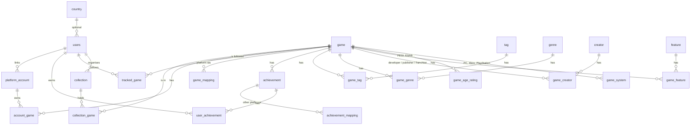

# Lavrel — Backend

[](https://github.com/hectordev4/lavrel-backend/actions/workflows/ci.yml)

A Spring Boot backend for an **achievement tracker**: people sign in with Google or e-mail, link their game
platform accounts, follow the games they are playing, and see their achievements with unlock percentages worldwide
and per country. Steam works today; Xbox and PSN plug in through the same platform layer.

The catalog of games is built from Steam and kept **safe for work**: adult games are filtered out, so search and game
pages are public and can be shown to people who are not logged in.

> This README describes what exists **right now**. The [Roadmap](#roadmap) lists what is next, and the
> [Decisions log](#decisions-log) records choices that are already made. Update both as the project moves.

---

## Contents

1. [Status](#status)
2. [Tech stack](#tech-stack)
3. [Architecture](#architecture)
4. [Getting started](#getting-started)
5. [Configuration](#configuration)
6. [Database](#database)
7. [Authentication, roles and privacy](#authentication-roles-and-privacy)
8. [Platforms: linking and syncing](#platforms-linking-and-syncing)
9. [The catalog and the content policy](#the-catalog-and-the-content-policy)
10. [Search](#search)
11. [Tracking list and quick access](#tracking-list-and-quick-access)
    - [My library and collections](#my-library-and-collections)
12. [API reference](#api-reference)
13. [Postman collection](#postman-collection)
14. [Testing](#testing)
15. [Troubleshooting](#troubleshooting)
16. [Roadmap](#roadmap)
17. [Decisions log](#decisions-log)
18. [Changelog](#changelog)

---

## Status

| Area | State |
|---|---|
| Sign-in with Google or e-mail + password (Firebase ID token verified by the backend) | Working |
| E-mail verification required for everything except the own profile | Working |
| Users: public id, free display name, roles (`USER`, `SUPPORT`, `ADMIN`), optional country | Working |
| Link a platform account (Steam today, through a platform registry) | Working |
| Sync a Steam library: games, achievements, unlocks, `lastSyncedAt` | Working |
| Catalog from Steam: tags, genres, developers, publishers, franchises, features, age ratings | Working |
| Safe-for-work content policy, with admin-managed exceptions | Working |
| Statistics: global and per-country unlock percentages | Working |
| Public search: full search with filters, type-ahead, filter options | Working |
| Tracking list with statuses, progress cards and quick access (20 pins) | Working |
| Admin tools: seed, walk all of Steam, enrich, refresh, exceptions, roles | Working |
| My library (owned games, progress, filters) and collections of owned games | Working |
| Achievement list per game with unlock state and percentages | Working |
| Unlink a platform account; delete my account (Firebase sign-in included) | Working |
| Build and tests on every push and pull request (GitHub Actions) | Working |
| Systems a game is available on (PC, Xbox, PlayStation), on game pages and as a search filter | Working |
| Rate limiting on every endpoint; short browser caching of the public catalog | Working |
| Automatic library sync (every 6 hours, only games played since the last sync; users can turn it off) | Working |
| Public profiles (opt-in) with customizable shelves, player search, avatars (generated, gallery, upload) | Working |
| AI achievement guide: "how do I get this?" and follow-ups (Cloudflare Workers AI, licensed wikis, saved guides) | Working |
| Comments between players | Planned |
| Xbox and PSN | Planned (the platform layer is ready) |

## Tech stack

- **Java 21+**, **Spring Boot 4.1**, Maven
- **PostgreSQL** on **Supabase**, schema owned by **Flyway**, Hibernate 7 only validates it; `pg_trgm` and `unaccent`
  for search
- **Firebase Authentication** (the frontend signs in; the backend verifies the ID token with the Admin SDK)
- **Spring Security 7**, stateless, one custom filter; **Bean Validation** on every request
- Steam **Web API** and the Steam store backend, through Spring's `RestClient` and Jackson 3
- Tests: JUnit 5, AssertJ and Mockito (unit tests, no database needed)

## Architecture

**Hexagonal (ports and adapters), organised by feature.** Each feature has the same three layers:

```
feature/
├── domain/                     plain Java: no Spring, no JPA
├── application/
│   ├── port/in/                what the feature offers (use cases)
│   ├── port/out/               what the feature needs (repositories, external services, read queries)
│   └── service/                implements the in-ports, uses the out-ports
└── adapter/
    ├── in/web/                 REST controllers, with their request/response DTOs nested inside
    └── out/persistence/        JPA entities, repositories, mappers, JDBC adapters
```

### Features

| Package (`com.lavrel.…`) | Responsibility |
|---|---|
| `user` | Users, public ids, roles, usernames, countries, linked platform accounts, sign-in and account linking |
| `catalog` | Games, achievements, mappings, tags, genres, creators, features, content policy and exceptions, Steam import, search |
| `library` | The games a user owns and the sync of an account |
| `progress` | Unlocks and statistics |
| `tracking` | The tracking list (statuses, progress cards) and quick access |
| `profile` | Public profiles (opt-in), shelves, player search and avatars |
| `assistant` | The AI achievement guide: saved guides, reference wikis, daily limits, the model adapter |
| `platform.adapter.out.steam` | Steam clients only (`SteamLibraryClient`, `SteamCatalogClient`, `SteamOpenIdVerifier`). No business logic |
| `shared` | `Platform`, `PlatformRegistry`, error format, security configuration, `Clock`, Firebase setup |
| `devtools` | Development-only tools: fake data and the one-time e-mail verification |

### Rules

1. `domain` never depends on Spring or JPA.
2. A feature talks to another feature **only through its `port.in`**, and passes IDs or small views, not domain objects.
3. Platform data is translated to our own IDs in the application layer. Adapters return raw platform data.
4. Network calls never run inside a database transaction.
5. **Nothing names a platform outside its adapter.** Every per-platform port (library, catalog, identity, game importer)
   extends `PlatformBound`, and services pick the implementation through `PlatformRegistry`. Adding Xbox means adding
   adapters, not editing services. A platform with no adapter answers `422 platform_not_supported`.
6. **Entities are classes, fixed data are records.** `User`, `PlatformAccount`, `Game` and `TrackedGame` change over
   time: private constructor, a factory for new ones (`register`, `linkVerified`, `create`, `track`), `restore(...)` for
   the mappers only, and methods for every change. Everything else (`Country`, `Achievement`, `GameMetadata`, DTOs)
   stays a record.
7. **The database id never leaves the backend.** Users are identified by their public id, linked accounts by platform
   and external id; not-found messages never contain internal ids.
8. Known exceptions to rule 2: read-model query adapters (statistics, tracking cards, search) read other features'
   tables, read-only.

```
src/main/java/com/lavrel
├── LavrelApplication.java
├── shared/      config · domain (Platform, PlatformRegistry…) · error · security · web
├── user/        domain · application · adapter
├── catalog/     domain · application (service/steam: the Steam import) · adapter
├── library/     domain · application · adapter
├── progress/    domain · application · adapter
├── tracking/    domain · application · adapter
├── platform/    adapter/out/steam
└── devtools/    fake data, one-time e-mail verification
src/main/resources
├── application.yml
└── db/migration/   V1 … V31
```

### The Steam import (`catalog/application/service/steam`)

| Class | Responsibility |
|---|---|
| `SeedSteamCatalogService`, `EnrichGamesService`, `RefreshGamesService`, `ImportSteamGamesService`, `ContentExemptionService` | Thin use-case services (admin seeding, enrich, refresh, account syncs, exceptions) |
| `SteamGameScreening` | Cheap and full rejection checks (type, content policy, minimum reviews); no I/O |
| `SteamImportRun` | The batch loop: known and failed apps are free, store items 25 per call, attempt budget, resume point |
| `SteamGameReprocessor` | Re-checks existing games (enrich and refresh only differ in which games they pick) |
| `SteamGameWriter` | Writes a game with its mapping, achievements and details in one transaction |
| `SteamTagNames` | Steam tag names; one shared bean, so all paths together ask Steam at most once an hour |
| `GameMetadataAssembler` | Turns the store item and the store page into `GameMetadata`; pure functions |

## Getting started

### Requirements

- Java 21 or newer, Maven 3.9+
- A **Supabase** project (Postgres)
- A **Firebase** project with Google and Email/Password sign-in enabled, **one account per e-mail address** kept on, and
  a **service-account key**
- A free **Steam Web API key**: <https://steamcommunity.com/dev/apikey> (domain `localhost` is fine for development)

### Steps

1. Create `.env` in the project root and fill it in (see [Configuration](#configuration)). `.env` must be in `.gitignore`.
2. Put the Firebase service-account JSON outside git, for example `secrets/firebase-service-account.json`
   (also in `.gitignore`), and point `FIREBASE_CREDENTIALS_PATH` at it.
3. Generate the link-state secret: `openssl rand -hex 32`, and put it in `STEAM_STATE_SECRET`.
4. Start it from the project folder:

   ```
   mvn -e spring-boot:run
   ```

5. Check it: `curl -i http://localhost:8080/actuator/health` should answer `200` with `{"status":"UP"}`.

On the first start Flyway creates the whole schema (including 50 development countries).

### First admin and test account

1. Sign in once (Postman request 1, then 2) so your user row exists.
2. In the Supabase SQL editor: `UPDATE users SET role = 'ADMIN' WHERE firebase_uid = '<your Firebase UID>';`
3. If your test e-mail cannot receive mail, verify it once with the development shortcut: set
   `app.dev.verify-email-uids: <your Firebase UID>` under `app:`, restart, run Postman **1 → 26 → 1**, then remove the
   property and restart. Real users verify through the link Firebase e-mails them.

### Quick manual test

1. Import the Postman collection (see [Postman collection](#postman-collection)).
2. Run request **1** (signs in to Firebase and stores the ID token), then **2** (`GET /api/currentuser`).
3. A `200` with your `publicId` and `"emailVerified": true` means the whole chain works.
4. Without any token, request **39** (`GET /api/games`) should already answer: search is public.

### Deploying

The backend ships as a Docker image (`Dockerfile`, Java 21, non-root) and runs on **Google Cloud Run** inside its free
monthly allowance. The image is built in Google Cloud, so Docker is not needed locally. Step by step, including secrets
and costs: [docs/DEPLOY.md](docs/DEPLOY.md). Locally, keep using `mvn spring-boot:run`.

## Configuration

### Environment variables (`.env`)

| Variable | Required | Purpose |
|---|---|---|
| `DB_URL` | yes | JDBC URL. Use Supabase's **Session pooler** (port 5432) with `?sslmode=require` |
| `DB_USER` | yes | `postgres.<project-ref>` for the pooler |
| `DB_PASSWORD` | yes | Database password |
| `FIREBASE_CREDENTIALS_PATH` | yes | Path to the Firebase service-account JSON |
| `STEAM_API_KEY` | yes | Steam Web API key |
| `STEAM_STATE_SECRET` | yes | At least 32 characters; signs the account-link `state` |
| `STEAM_CALLBACK_URL` | no | Default `http://localhost:8080/api/steam/callback` (`/api/platforms/steam/callback` works too) |
| `FRONTEND_BASE_URL` | no | Empty: the link callback answers JSON. Set: it redirects to `{url}/{platform}/linked` |
| `CLOUDFLARE_ACCOUNT_ID` | no | Cloudflare account id, for the AI assistant (Workers AI) |
| `CLOUDFLARE_AI_TOKEN` | no | Cloudflare API token limited to **Workers AI**. A secret. Without both the assistant answers `503` |
| `SUPABASE_URL` | no | `https://<project>.supabase.co`, for avatar uploads (Supabase Storage). Without it uploads answer `503` |
| `SUPABASE_SERVICE_KEY` | no | Supabase **service-role** key, for avatar uploads. A secret: backend environment only |
| `FAKE_DATA_ENABLED` | no | `true` enables the fake-data endpoints (development only) |
| `CORS_ALLOWED_ORIGINS` | no | Browser origins allowed to call the API, comma-separated. Default `http://localhost:4200` |
| `PORT` | no | HTTP port; set by Cloud Run. Default `8080` |

Spring does not read `.env` by itself: `application.yml` imports it with
`spring.config.import: optional:file:.env[.properties]`, so run the app from the project root.

### Application properties (`application.yml`)

| Property | Default | Meaning |
|---|---|---|
| `app.stats.min-country-sample` | `20` | Country percentages are hidden below this many players |
| `app.sync.max-imports-per-sync` | `40` (`50` in the yml) | New games imported per account sync |
| `app.catalog.min-reviews` | `50` | Bulk seeding drops games with fewer reviews |
| `app.catalog.failure-retry-days` | `30` | Rejected apps are not asked about again for this long |
| `app.catalog.import-delay-ms` | `300` (`500` in the yml) | Pause between Steam calls |
| `app.catalog.seed-delay-ms` | `1000` | Pause between Steam calls while walking all of Steam |
| `app.catalog.filter.enabled` | `true` | `false` switches the content policy off |
| `app.catalog.filter.*` | see `CatalogFilterProperties` | Descriptor ids, sexual tag ids, top-5 share, excluded tags; defaults below |
| `app.link.state-secret` / `app.link.state-ttl` | `app.steam.*` / `PT10M` | Account-link `state`; the old `app.steam.*` keys still work |
| `app.cors.allowed-origins` | `http://localhost:3000,http://localhost:5173` | Browser origins allowed to call the API. **Add `http://localhost:4200` for the Angular dev server** |
| `app.rate-limit.anonymous-per-minute` | `60` | Requests per minute for one anonymous caller (by address) |
| `app.rate-limit.anonymous-total-per-minute` | `600` | Requests per minute for all anonymous callers together |
| `app.rate-limit.user-per-minute` | `120` | Requests per minute for one signed-in user (admins are not limited) |
| `app.rate-limit.syncs-per-hour` | `20` | Account syncs per hour for one user |
| `app.auto-sync.enabled` | `true` | `false` turns the automatic sync off for everyone |
| `app.auto-sync.every` | `PT6H` | An account is synced automatically at most this often |
| `app.auto-sync.check-every` / `first-run-after` | `PT30M` / `PT10M` | How often the scheduler looks for accounts to sync, and the wait after start-up |
| `app.auto-sync.active-days` / `batch-size` / `pause-ms` | `30` / `20` / `1000` | Only users seen in this many days; accounts per round; pause between accounts |
| `app.assistant.model` | `@cf/meta/llama-3.1-8b-instruct-fp8` | The Workers AI model that writes answers (env `APP_ASSISTANT_MODEL`). Cloudflare retires models: if the log says the model is not offered (410), pick another from its catalog |
| `app.assistant.user-daily-limit` / `global-daily-limit` | `20` / `400` | New answers per user per day, and for everyone together (protects the free daily AI allowance); saved guides are not counted |
| `app.assistant.max-tokens` | `600` | Longest answer |
| `app.steam.image-base` | `https://shared.fastly.steamstatic.com/community_assets/images/apps/` | Host Steam achievement icons are served from (env `APP_STEAM_IMAGE_BASE`); applied to every icon at start-up |
| `app.catalog.icon-bucket` | `achievement-icons` | Supabase Storage bucket for icons copied into our storage |
| `app.dev.verify-email-uids` | not set | Development only: enables the one-time e-mail verification for these Firebase UIDs. Remove after use |

## Database

### Connecting to Supabase

- Use the **Session pooler** (port 5432), with the user `postgres.<project-ref>`.
  The direct connection is IPv6-only unless you buy the IPv4 add-on and fails with *No route to host* on many networks.
- Do **not** use the transaction pooler (port 6543): it breaks Flyway.
- Row Level Security is enabled on every table with no policies, so Supabase's public REST API cannot read any data.
  The backend connects as `postgres`, which bypasses it. After the first start run once in the SQL editor:
  `alter table public.flyway_schema_history enable row level security;`

### Migrations (Flyway)

Flyway is the only source of schema changes. Never edit a migration that has been applied: add a new one.

| Version | What it does |
|---|---|
| V1 | `country` (50 development countries), `users` |
| V2 | `platform_account` (unique per platform and external id) |
| V3 | `game`, `game_mapping` |
| V4 | `achievement`, `achievement_mapping` |
| V5 | `account_game` |
| V6 | `user_achievement` (one row per user and achievement) |
| V7 | `game.description`, `game.store_url`, `catalog_import_failure` |
| V9 | Game details: tags, creators, features, age ratings, release, platforms, reviews, `enriched_at` |
| V10 | Genres, `refreshed_at` |
| V11 | Random usernames (superseded by V12: usernames are no longer unique) |
| V12 | `users.public_id` (random 16 digits), `users.role`, drops the unique username index |
| V13 | `users.email_verified` |
| V14 | `game.content_exempt` (content-policy exceptions) |
| V15 | `tracked_game` (tracking list and quick-access pins) |
| V16 | Search: `pg_trgm`, `unaccent`, `lavrel_normalize()`, `game.search_name` with a trigram index, sort indexes |
| V17 | `collection`, `collection_game` (collections of owned games) |
| V18 | Longer achievement texts (names and Steam ids up to 1024 characters, descriptions up to 8000) |
| V19 | The full country list (ISO 3166-1), except countries under US sanctions where Steam is not offered and uninhabited territories |
| V20 | `game_system` (PC, Xbox, PlayStation), with PC filled for every Steam game |
| V21 | `users.last_seen_at`, `users.auto_sync` (automatic library sync) |
| V22 | `profile_settings` (public profile and what it shows; everything private by default) |
| V23 | `profile_shelf`, `profile_shelf_achievement` (profile shelves) |
| V24 | Avatar kind and value on `profile_settings` |
| V25 | `assistant_guide` (saved guides), `assistant_usage` (daily limits) |
| V26 | `assistant_wiki` (approved reference wiki per game) |
| V27 | `profile_settings.show_library_size` (games-owned number on public profiles; off by default) |
| V28 | `franchise_blocklist` (names marked as "not a franchise"; seeded with EA Play) |
| V29 | `game.slug`: unique, permanent page addresses (`lavrel_slug()`, filled for existing games, set by a trigger for new ones) |
| V30 | Index for "my latest unlocks" (user, unlock date newest first) |
| V31 | Achievement icons: `icon_path` (Steam reference), `icon_mirrored`, `app_setting` (Steam image host), trigger that serves every Steam icon from the current host |

There is no V8 on purpose (it was superseded by V9 before release). Flyway does not need consecutive numbers.
Check what is applied with:
`select version, description, success from flyway_schema_history order by installed_rank;`

### Tables



Also: `catalog_import_failure` (apps Steam gave us that were rejected, and why) and `flyway_schema_history`.

Deleting a game or a user removes everything attached to it (foreign keys are `ON DELETE CASCADE`).

**Published games.** A game is only visible through the API once `game.enriched_at` is set, which happens when its
details were copied and it passed the content policy (or has an exception). Games without details stay hidden.

**`achievement_mapping`** is empty until Xbox or PSN exist: it maps each Steam-based achievement to its id on another
platform (or marks it unavailable there), so unlocks from any platform land on the same achievement.

## Authentication, roles and privacy

**Login happens in the frontend.** The Firebase JS SDK signs the person in (Google, or e-mail and password) and gives the
frontend an **ID token**. The frontend sends it with every call as `Authorization: Bearer <token>`. The backend only
**verifies** the token (signature, expiry, project) and finds or creates the user by Firebase UID. Passwords never
reach the backend. There is no login by username.

### Who can call what

| Caller | Can call |
|---|---|
| Anyone, no token | `GET /actuator/health`, the link callbacks, and the public catalog: `GET /api/games`, `/api/games/{id}`, `/api/games/slug/{slug}`, `/api/games/{id}/achievements`, `/api/search`, `/api/tags`, `/api/creators`, public profiles (`/api/users`), `/api/avatars/gallery` |
| Signed in, e-mail **not** verified | Only `GET /api/currentuser` (it returns `emailVerified: false`, so the frontend shows "check your inbox") and `DELETE /api/currentuser`. Everything else is `403 email_not_verified` |
| Signed in and verified | Everything for users |
| Role `ADMIN` (and verified) | `/api/admin/**` |

- Google accounts are always verified. E-mail accounts are verified once the person clicks Firebase's link; the frontend
  then refreshes the token with `getIdToken(true)`.
- **Roles** are stored in `users.role`: everyone starts as `USER`; an admin promotes people with
  `PATCH /api/admin/users/{publicId}/role` (never their own role). `SUPPORT` has no extra permissions yet.
- A rejected token always gives the same `401`; the real reason is written to the server log (never the token).
- The service-account key is a **backend secret**. The Firebase web config belongs only in the frontend.

### Public ids, usernames and private data

- Every user has a **public id**: a random 16-digit number, drawn again if taken. It is what other people will see
  (profile addresses, community features). The sequential database id never leaves the backend.
- The **username** is a free display name, **not unique** (the public id tells people apart): 2 to 32 characters,
  letters of any alphabet, digits, spaces and `_ . - ' ! ? & # ( ) [ ]`. Names posing as staff are rejected, even
  disguised (`a.d.m.i.n`).
- New users start with a friendly random name such as `SwiftOtter` or `SleepyWaffle` (one adjective and one noun from
  two neutral lists). The name never comes from the Google account.
- The e-mail and photo of the sign-in account are **private**: only the user sees them, through `GET /api/currentuser`.
  `User.toString()` leaves them out, so they never reach the logs.
- The optional **country** is only used for aggregate statistics.

## Platforms: linking and syncing

### Linking an account

The platform redirects the browser back **without** any login token, so the backend identifies the user with a
short-lived, signed `state` that is also bound to the platform:

1. The frontend calls `POST /api/currentuser/accounts/{platform}/link` (e.g. `steam`) and gets `{"redirectUrl": "…"}`.
2. The frontend sends the browser to that login page.
3. The platform sends the browser back to `GET /api/platforms/{platform}/callback` (Steam's registered
   `/api/steam/callback` still works).
4. The backend checks the `state`, asks the platform to confirm the login (Steam: OpenID `check_authentication`), and
   stores the account for that user. A platform account can be linked once, to one user.
5. With `FRONTEND_BASE_URL` set, the browser is redirected to `{url}/{platform}/linked?status=success`
   (or `status=error&reason=…`). Without it, the callback answers JSON.

### Syncing a library

`POST /api/currentuser/accounts/{platform}/{externalId}/sync` (e.g. `/accounts/steam/76561198…/sync`) reads the user's
library and brings the database up to date. Accounts are addressed by the platform's own id, never our database id;
someone else's account answers `404` like a missing one.

- The Steam profile's **Game details** must be **Public**; otherwise the sync answers `422 profile_private`.
- New games go into the catalog **except** adult games (unless an admin made an exception) and games without
  achievements.
- Up to `app.sync.max-imports-per-sync` **new** games are imported per sync, most played first. `gamesPending` says how
  many are still waiting: the user syncs again to continue.
- Rejected games are remembered for `failure-retry-days`, so they cost no Steam calls on later syncs.
- Unlocks are recorded once per user and achievement. `lastSyncedAt` is shown in `GET /api/currentuser/accounts`.
- The sync runs inside the request (it can take a while for a big library).

### Automatic sync

Every 30 minutes a scheduler takes up to 20 accounts that were last synced more than 6 hours ago, from users who used
the app in the last 30 days and kept **automatic sync** on (`GET` / `PUT /api/currentuser/auto-sync`, on by default).
It reads the library, imports new games, and reads unlocks **only for games played since the last sync**, so an
account costs a handful of Steam calls instead of one per game. A private profile or an odd game marks the account
as synced and moves on; if Steam fails or rate-limits, the round stops and the rest waits for the next one. The
manual sync stays a full sync. On Render's free plan the scheduler only runs while the app is awake, which is what the
keep-awake monitor is for.

## The catalog and the content policy

### What is stored for each game

Available on: **systems** by family (PC, Xbox, PlayStation). PC comes from Steam; Xbox and PlayStation are set by an
admin until their adapters exist. A system is not a linkable account: Nintendo can be added later even without one.


Title, description, cover, Steam store page, release date, platforms, review count and percentage, free flag, required
age, **developers, publishers and franchise**, **tags** (top 20 with Steam's weight), **genres**, **features**
(player modes, accessibility, controller support…), and **age ratings** (PEGI, ESRB, USK, CERO…). All of it is
**copied into our database**: nothing is read from Steam when someone views or searches a game.

Tags, genres and details never change on their own. Only the admin **refresh** re-copies them.

**Achievement icons.** Steam's API still hands out icon addresses on old hosts (such as `steamcdn-a.akamaihd.net`)
that stopped answering. Each achievement therefore keeps its Steam reference (`{appId}/{file}.jpg`, column
`icon_path`), and a database trigger serves every Steam icon from the host in `app.steam.image-base`, applied to all
icons at each start-up: if Steam moves again, change that setting and restart. For a game whose icons Steam really
lost or may lose, an admin can **copy them into our storage** (bucket `achievement-icons`): our copy is then served,
kept through refreshes while the Steam picture is the same, and can be dropped again. Icons are Valve's and the
publishers' images, so copies are made per game, only where needed.

**Franchises.** Steam's franchise field is filled by publishers and often holds the studio's own name ("Team17
Digital"), a store or subscription brand ("EA Play") or a placeholder ("FRANCHISE"). `FranchiseRules` skips those at
import: a franchise is rejected when, ignoring case, accents and company endings (Digital, Games, Studios, Inc., Ltd…),
it equals one of the game's developers or publishers, when it is a placeholder word, or when an admin blocked it. For
data stored earlier, the admin clean-up shows what the rules reject before removing anything.

### Safe for work

Every game must pass the content policy before it enters the catalog (`ContentPolicy`, configured under
`app.catalog.filter.*`):

| Layer | Rule |
|---|---|
| Publisher descriptors | Descriptor **3** (Adults Only Sexual Content) rejects. Descriptor **4** (Frequent Nudity or Sexual Content) rejects only when *Sexual Content* or *Nudity* is among the game's top 3 tags |
| Tag weights | *Sexual Content* or *Nudity* in the top 3 tags **and** holding at least 20 % of the top-5 weight rejects |
| Hard exclusions | The *Hentai* tag (9130, 6653) at any rank; a non-game type (DLC, soundtrack, video…) |

Mainstream games with some nudity stay (The Witcher 3 has *Nudity* 8th). Visual Novel, Match 3 and Puzzle games are
allowed on purpose. Violence alone is never blocked.

**Exceptions.** Some safe games have misleading user tags (Marvel Rivals). An admin exempts them with
`POST /api/admin/catalog/steam/exceptions`: the game is imported (or kept) without the content policy, and enrich and
refresh never remove it for content reasons. It must still be a real game with achievements. The flag is
`game.content_exempt`; every exception added or removed is logged.

### Spending as few Steam calls as possible

- Apps already in the catalog and apps already rejected cost **nothing**.
- A page of 25 games' tags, descriptors, creators, reviews and categories comes from **one** batched call. Non-games,
  adult games and (in bulk seeding) obscure games are rejected from that data alone.
- Only the survivors cost per-game calls: an achievement check, then the store page.
- Steam being down or rate-limiting is **never** remembered as a permanent rejection.

### Admin tools

All need the `ADMIN` role. The Steam ones are slow on purpose (a pause between Steam calls); the Postman collection has
a request for each, with a Collection Runner recipe for the long ones.

| Endpoint | Use |
|---|---|
| `POST /api/admin/catalog/steam/seed` | `{"limit": 100}` imports Steam's most-played games; `{"appIds": [...]}` imports specific ones |
| `POST /api/admin/catalog/steam/seed-next` | Resumable walk through **all** of Steam: `{"cursor": 0, "limit": 100}`; feed `nextCursor` back until `hasMore` is false |
| `POST /api/admin/catalog/steam/enrich` | Gives details to games that never had them; adult ones are removed |
| `POST /api/admin/catalog/steam/refresh` | Re-copies tags, genres and details of published games; a game that no longer passes is removed |
| `POST /api/admin/catalog/steam/exceptions` | `{"appIds": ["2767030"]}` exempts games from the content policy |
| `GET /api/admin/catalog/steam/exceptions` | Lists the exempt games |
| `DELETE /api/admin/catalog/steam/exceptions/{appId}` | Removes an exception; the next refresh judges the game again |
| `PATCH /api/admin/users/{publicId}/role` | `{"role": "SUPPORT"}`: `USER`, `SUPPORT` or `ADMIN` |
| `PUT` / `DELETE /api/admin/catalog/games/{gameId}/systems/{system}` | Mark or unmark a game as available on `pc`, `xbox` or `playstation` |
| `DELETE /api/admin/users/{publicId}/avatar` | Remove someone's picture (moderation) |
| `PUT` / `GET` / `DELETE /api/admin/assistant/wikis/{gameId}` | Approve, list or remove a game's reference wiki (`{"apiUrl", "license"}`) |
| `DELETE /api/admin/assistant/guides/games/{gameId}` | Forget a game's saved guides |
| `POST /api/admin/catalog/games/{gameId}/icons/refresh` | Read the game's achievement icons from Steam again |
| `POST` / `DELETE /api/admin/catalog/games/{gameId}/icons/mirror` | Copy the game's icons into our storage and serve them from there (reports any Steam no longer has) / back to Steam, deleting our copies |
| `POST /api/admin/catalog/franchises/cleanup?apply=false` | Lists stored franchises the rules reject (studio names, store brands, placeholders); `apply=true` removes those links |
| `PUT` / `DELETE /api/admin/catalog/franchises/{creatorId}/blocked`, `GET .../franchises/blocked` | Mark a creator as "not a franchise" (removes its links, skipped by future imports), undo, list |

Limits are validated: `limit` 1–200, app ids numeric, at most 500 per request.

## Search

All search endpoints are **public** and only return published, safe-for-work games.

- **Full search**, `GET /api/games`: the results page; browse pages ("all Roguelike games", "the Monster Hunter series")
  are this call with a preset filter.
- **Type-ahead**, `GET /api/search?q=`: 5 games, 5 tags and 3 franchises for the header dropdown.
- **Filter options**, `GET /api/tags?q=` and `GET /api/creators?role=franchise|developer|publisher&q=`: the dropdowns,
  with the number of games, prefix matches first.

| Parameter of `GET /api/games` | Meaning |
|---|---|
| `q` | 2–100 characters. Matches the name ignoring case, accents and punctuation, and tolerates typos ("witcer" finds The Witcher, "pokemon" finds Pokémon) |
| `tag` | Up to 5 tag ids; **all** must apply. A tag counts only when it really describes the game: among its top 10 tags, or holding at least a quarter of its top tag's weight |
| `franchise`, `developer`, `publisher` | Creator ids from `/api/creators` |
| `mode` | `single-player`, `co-op`, `multiplayer`; all must be offered |
| `system` | `pc`, `xbox`, `playstation`; the game must be available on all of them |
| `sort` | `relevance` (default with `q`: exact name, starts with, contains, close matches), `popular` (default without `q`: most reviews), `rating` (needs 100 reviews to rank high), `newest`, `name` |
| `page`, `size` | From 0; size 20 by default, at most 50. `hasMore` tells whether there is a next page (no slow total count) |

Name matching is done in Postgres: `lavrel_normalize()` (V16) turns "The Witcher® 3: Wild Hunt" into
"the witcher 3 wild hunt" for both the stored `game.search_name` and the query, and `pg_trgm` handles typos and ranking.

## Tracking list and quick access

The tracking list is the user's own list of games to follow. **Only the user adds games**; a sync never does. Any
catalog game can be tracked, owned or not (games from a sync are in the catalog).

- Each game has a **status**: `PLAYING`, `BACKLOG`, `COMPLETED` or `DROPPED`.
- Each card shows **progress** (unlocked of total) and the **3 easiest achievements not unlocked yet**, by share of the
  game's owners who unlocked them. Hidden achievements are flagged so the frontend can blur them.
- Default order: **newest store release first** (games without a date last); `sort=title` and `sort=updated` too.
- **Quick access**: up to **20** pinned games, in the user's own order (positions 1..n, no gaps). The 21st answers
  `409 quick_access_full`. Removing a game from the list also unpins it.

## Public profiles

**Nothing is public unless the user turns it on.** A profile that is not public answers `404 profile_not_found` (the
same as a user that does not exist) and never appears in the player search.

- **Header:** username, public id and the month the user joined. Each of these is a separate opt-in, off by default:
  country, **platform badges** (only "plays on Steam / Xbox / PSN", never account names or ids) and the **picture**.
- **Shelves:** everything else is a shelf the user adds, titles, orders and removes (up to 10). Whatever is not on a
  shelf is never shown.

| Shelf | Shows |
|---|---|
| `COLLECTION` | One of the user's collections (putting it on a shelf is what makes it public) |
| `RECENTLY_PLAYED` | The last 6 games played |
| `PLAYING` | Tracked games marked `PLAYING` |
| `COMPLETED` | Games with every achievement unlocked |
| `ACHIEVEMENTS` | Up to 12 achievements the user picked from their own unlocks, with rarity |
| `STATS` | Achievements unlocked and games completed; games owned only with `showLibrarySize` on (the only place that number can appear) |

- **Player search:** `GET /api/users?q=` by name (2+ characters, accent and case insensitive) or an exact public id.

### Avatars

Every user has one avatar of one kind:

| Kind | What | Stored |
|---|---|---|
| `GENERATED` (default) | Drawn by the frontend with DiceBear from the public id | Nothing |
| `GALLERY` | One of 36 default pictures (`gallery-01` … `gallery-36`); the images are CC0 art in the frontend | The id |
| `UPLOADED` | The user's own JPG, PNG or GIF | Supabase Storage, bucket `avatars` |

Uploads are sent as the request body (not a form), at most 2 MB. The type is read from the file's content, never its
name. JPG and PNG are cropped to a square, resized to 256×256 and re-encoded, which also removes hidden photo data
such as the GPS location; PNG keeps its transparency. GIFs are kept exactly as uploaded, animation and transparency
included, if they are at most 1 MB, 512×512 and 300 frames. Others only see the picture if `showAvatar` is on;
otherwise they see the generated one. Admins can remove a picture (`DELETE /api/admin/users/{publicId}/avatar`).

## AI achievement guide

On an achievement, a signed-in player asks **"how do I get this?"** and can then ask follow-up questions about it.

- **Model:** Cloudflare **Workers AI** (default `@cf/meta/llama-3.1-8b-instruct-fp8`), called by the backend through
  `LanguageModelPort`, so it can be replaced by another provider with one adapter. The free plan gives a daily
  allowance; when it is used up Cloudflare refuses (no bill) and players get `503 assistant_unavailable`.
- **Knowledge:** when an admin approved a **reference wiki** for the game (a MediaWiki such as Fandom or wiki.gg whose
  license allows reuse, e.g. CC BY-SA), the backend searches it for the achievement, keeps the relevant part of the
  best pages and gives it to the model; the answer is `grounded` and lists its `sources` (page, link, license).
  Otherwise the model answers from its own knowledge, `grounded: false`, which the frontend should flag as possibly
  inaccurate. Wiki text is read live and never stored; only the answer and the links are.
- **Saved guides:** the first answer for an achievement (per language) is saved and reused for everyone: grounded ones
  for 30 days, others for 7. They never contain anything about the player. Follow-ups are never saved.
- **Limits:** 20 new answers per player per day and 400 for everybody (saved guides are free), checked atomically in
  the database, on top of the general rate limiting.
- **Spoilers:** for hidden achievements nothing is generated until the player sends `spoilers=true`
  (status `SPOILER_CONSENT_REQUIRED`).
- **Safety:** the model has **no tools**: it only receives text and returns text, so it cannot read or change
  anything. Reference text is fenced and declared as data, not instructions. Answers are Markdown: render them as
  text, never as raw HTML. Only the game and the achievement are sent, never the player's e-mail, name or progress.
- **Admins** approve a wiki per game (`PUT /api/admin/assistant/wikis/{gameId}`), checking its license first. Only
  public `https` domain names ending in `/api.php` are accepted (no IP addresses or internal hosts), and changing a
  game's wiki forgets its saved guides.

## Rate limiting and caching

The API runs on free plans (Render, Supabase), so every request goes through a rate limiter (`RateLimitFilter`, after
authentication):

| Caller | Limit (defaults, `app.rate-limit.*`) |
|---|---|
| Anonymous, per address | 60 requests per minute |
| All anonymous callers together | 600 per minute (faking addresses cannot get around it) |
| Signed-in user | 120 per minute |
| Account syncs | 20 per hour per user (they call Steam a lot; enough to import a big library in steps) |
| Admins, health check | Not limited |

Over the limit the answer is `429 too_many_requests` with `Retry-After` (seconds); the frontend can read that header.
The buckets live in memory: there is one instance, and a restart only forgets who was close to the limit.

Public catalog answers carry `Cache-Control`, so browsers reuse them: game pages and anonymous achievement lists for
5 minutes, search and the type-ahead for 1 minute, tag and creator options for 10 minutes. Anything with the caller's
own data is never cached.

## My library and collections

**My library** (`GET /api/currentuser/games`) is every game the user owns in any linked account, as long as it is
published in the catalog: cover, name, progress (unlocked of total), playtime, last played, which accounts own it and
whether it is tracked or pinned. It takes the same filters as search and is sorted by **last played** by default.

**Collections** are named lists of the user's **own** games ("Platinum hunt", "Cozy games"); following games one does
not own is what the tracking list is for. A game can be in several collections; up to 50 collections per user, names
unique per user ignoring case. Collections are addressed by a public UUID. A game that leaves the library (an account is
unlinked) stays saved in its collections but is hidden until it is owned again. Browse one with
`GET /api/currentuser/games?collection={id}`.

## API reference

Base URL: `http://localhost:8080`. JSON everywhere. Calls that need login send `Authorization: Bearer <Firebase ID token>`.

### Public (no token)

| Method | Path | Description |
|---|---|---|
| GET | `/actuator/health` | Health check |
| GET | `/api/platforms/{platform}/callback`, `/api/steam/callback` | Where the platform redirects the browser after login |
| GET | `/api/games` | Full search (see [Search](#search)) |
| GET | `/api/games/{gameId}` | Game page (published games only; `404` otherwise) |
| GET | `/api/games/slug/{slug}` | The same game page, by its page address (`/games/{slug}`) |
| GET | `/api/games/{gameId}/achievements` | Achievement list with worldwide percentages; with a token also your unlocks and your country's percentage |
| GET | `/api/search?q=` | Type-ahead |
| GET | `/api/tags?q=` | Tag options |
| GET | `/api/creators?role=&q=` | Franchise, developer or publisher options |
| GET | `/api/users/{publicId}` | A public profile with its shelves |
| GET | `/api/users?q=` | Player search (public profiles only) |
| GET | `/api/avatars/gallery` | The gallery picture ids |

### Signed in (any e-mail state)

| Method | Path | Description |
|---|---|---|
| GET | `/api/currentuser` | Own profile: `publicId`, `firebaseUid`, `username`, `email`, `emailVerified`, `photoUrl`, `countryId`, `role` |
| DELETE | `/api/currentuser?confirm=true` | Deletes the account for good: our data and the Firebase sign-in account. `204`; `409 last_admin` for the only admin |

### Signed in and verified

| Method | Path | Description |
|---|---|---|
| PATCH | `/api/currentuser/username` | `{"username": "Héctor K."}`. `204` |
| PATCH | `/api/currentuser/country` | `{"countryId": 12}`; `null` clears it. `204` |
| GET | `/api/currentuser/stats` | My totals for the home screen: `achievementsUnlocked`, `averageCompletion` (percent, over games with at least one unlock, like Steam; `null` if none), `perfectGames`, `gamesOwned`. Private |
| GET | `/api/currentuser/achievements/recent?limit=3` | `{"achievements": [...]}`: my latest unlocks (1–20), with game, slug, rarity and `hidden` |
| GET / PUT | `/api/currentuser/auto-sync` | `{"enabled": false}`: automatic sync of my accounts (on by default) |
| GET / PATCH | `/api/currentuser/profile` | Profile settings: `public`, `showCountry`, `showPlatforms`, `showAvatar`, `showLibrarySize` (all off by default) |
| GET / POST | `/api/currentuser/profile/shelves` | My shelves; add one `{"type", "title"?, "collectionId"?}` |
| PATCH / DELETE | `/api/currentuser/profile/shelves/{id}` | New title / remove |
| PUT | `/api/currentuser/profile/shelves` | `{"shelfIds": [...]}`: new order |
| PUT | `/api/currentuser/profile/shelves/{id}/achievements` | `{"achievementIds": [...]}`: up to 12 of my unlocks |
| GET | `/api/games/{gameId}/achievements/{achievementId}/guide?spoilers=&lang=` | The AI guide: saved (free) or new (counts) |
| POST | `/api/games/{gameId}/achievements/{achievementId}/guide/questions` | `{"question", "spoilers", "lang"}`: a follow-up (counts, not saved) |
| GET | `/api/currentuser/assistant/usage` | `{"usedToday", "dailyLimit"}` |
| GET / PUT / DELETE | `/api/currentuser/profile/avatar` | My avatar / upload a picture (raw image body) / back to generated |
| PUT | `/api/currentuser/profile/avatar/gallery` | `{"galleryId": "gallery-07"}` |
| GET | `/api/countries` | `{"countries": [...]}`: about 240 countries |
| GET | `/api/currentuser/accounts` | `{"accounts": [...]}`: `platform`, `externalId`, `displayName`, `lastSyncedAt` |
| POST | `/api/currentuser/accounts/{platform}/link` | Returns the platform login URL |
| POST | `/api/currentuser/accounts/{platform}/{externalId}/sync` | Syncs one account |
| DELETE | `/api/currentuser/accounts/{platform}/{externalId}` | Unlinks it: its games leave the library and the unlocks recorded from it are removed. `204` |
| GET | `/api/games/{gameId}/stats` | `{"gameId", "achievements": [...]}`: global and own-country unlock percentages |
| GET | `/api/currentuser/games?q=&tag=&mode=&collection=&sort=` | My library: owned games with cover, progress, playtime; sort `recent` (default), `name`, `playtime`, `progress`, `newest` |
| GET | `/api/currentuser/collections` | My collections, in order, with game counts |
| POST | `/api/currentuser/collections` | `{"name": "Cozy games"}`: create (`201`) |
| PATCH / DELETE | `/api/currentuser/collections/{id}` | Rename / delete (the games stay in the library) |
| PUT | `/api/currentuser/collections` | `{"collectionIds": [...]}`: new order |
| PUT / DELETE | `/api/currentuser/collections/{id}/games/{gameId}` | Add an owned game / remove it. `204` |
| GET | `/api/currentuser/tracked?status=&sort=` | Tracking list: `{"games": [cards]}` |
| PUT | `/api/currentuser/tracked/{gameId}` | `{"status": "PLAYING"}`: add, or change the status |
| DELETE | `/api/currentuser/tracked/{gameId}` | Remove. `204` |
| GET | `/api/currentuser/tracked/quick-access` | Pinned games, in order |
| PUT | `/api/currentuser/tracked/{gameId}/pin` | Pin at the end |
| DELETE | `/api/currentuser/tracked/{gameId}/pin` | Unpin. `204` |
| PUT | `/api/currentuser/tracked/quick-access` | `{"gameIds": [7, 3]}`: new order, every pinned game once |

### Admin (`ADMIN` role)

The catalog and user tools listed in [Admin tools](#admin-tools).

### Development only

| Method | Path | Enabled by | Description |
|---|---|---|---|
| POST / DELETE | `/api/admin/dev/fake-data` | `FAKE_DATA_ENABLED=true` (and admin) | `{"users": 50, "gamesPerUser": 15}` creates fake players; `DELETE` removes them all |
| POST | `/api/dev/verify-my-email` | `app.dev.verify-email-uids` | Marks the caller's own e-mail as verified in Firebase, once. `404` for anyone not listed |

### Examples

`GET /api/games?q=witcher` (shortened):

```json
{
  "games": [{
    "id": 7, "title": "The Witcher 3: Wild Hunt", "slug": "the-witcher-3-wild-hunt",
    "releaseDate": "2015-05-18", "platforms": { "windows": true, "mac": false, "linux": false },
    "reviewCount": 839761, "reviewPercentPositive": 96, "topTags": ["Open World", "RPG", "Story Rich"],
    "modes": { "singlePlayer": true, "coOp": false, "multiplayer": false }
  }],
  "page": 0, "size": 20, "hasMore": false
}
```

`GET /api/currentuser/tracked?status=playing` (one card, shortened):

```json
{
  "games": [{
    "gameId": 7, "title": "The Witcher 3: Wild Hunt", "status": "PLAYING", "pinPosition": 1,
    "unlocked": 18, "total": 78,
    "nextAchievements": [{ "achievementId": 812, "name": "Lilac and Gooseberries", "hidden": false, "globalPercent": 64.2 }]
  }]
}
```

`slug` is the game's page address: the frontend uses `/games/{slug}` (for example `/games/dark-souls-iii`) and loads the game with `GET /api/games/slug/{slug}`. Slugs are unique (a repeated title gets `-2`, `-3`…), given once when the game is created, and never change, so shared links keep working if a title is edited.

### Errors

Every error is `{"error": "<code>", "message": "<text>"}`. Validation errors add `details`: one
`{"field", "problem"}` per invalid field or parameter.

| Status | Codes |
|---|---|
| 400 | `validation_failed`, `malformed_request`, `invalid_parameter`, `missing_parameter`, `invalid_username`, `country_not_found`, `invalid_identity_proof`, `invalid_comparison`, `invalid_role_change`, `invalid_quick_access_order`, `invalid_collection_name`, `invalid_collection_order`, `invalid_shelf`, `invalid_avatar`, `invalid_question`, `invalid_wiki_source` |
| 401 | `unauthorized` (missing or invalid token) |
| 403 | `email_not_verified`, `forbidden` |
| 404 | `user_not_found`, `platform_account_not_found`, `game_not_found`, `game_not_on_platform`, `game_not_tracked`, `game_not_in_catalog`, `collection_not_found`, `profile_not_found`, `shelf_not_found`, `achievement_not_found`, `creator_not_found`, `not_found` |
| 409 | `account_already_linked`, `already_verified`, `quick_access_full`, `collection_name_taken`, `collection_limit_reached`, `last_admin`, `shelf_limit_reached` |
| 422 | `profile_private`, `platform_not_supported`, `game_not_owned` |
| 429 | `too_many_requests` (with a `Retry-After` header, in seconds), `assistant_quota_exceeded` |
| 502 | `platform_unavailable`, `identity_provider_unavailable` |
| 503 | `avatar_storage_unavailable`, `storage_unavailable`, `assistant_unavailable` |

## Postman collection

File: `postman/lavrel_backend.postman_collection.json`. Import it in Postman, open the collection's **Variables** tab and
fill in the **Current value** column of `firebaseApiKey`, `email` and `password` (a Firebase e-mail/password user).
Run request **1** first: it stores the ID token, which expires after about an hour (run it again on a `401`).

| Requests | Purpose |
|---|---|
| 1, 2 | Sign in to Firebase and store the ID token; own profile |
| 3 – 10 | Countries, country, linked accounts (saves `accountPlatform` / `accountExternalId`), sync, stats, "no token" check |
| 11 | Start the Steam link (open the returned URL in a browser) |
| 12, 13 | Seed from Steam: most played, or specific app ids |
| 14, 15 | Fake players: create and delete |
| 16 | Game page |
| 17, 18 | Walk all of Steam (Collection Runner), and reset its cursor |
| 19, 20 | Enrich pending games and refresh from Steam (Collection Runner) |
| 21 | Set my username |
| 22 – 25 | Platform checks (Xbox not supported yet, unknown platform), validation errors, the generic callback |
| 26 | Development: verify my test e-mail once |
| 27 | Admin: change a user's role (`targetPublicId`) |
| 28 – 30 | Admin: content-policy exceptions (Marvel Rivals), list, remove |
| 31 – 34 | Tracking list: track, list, filter by status, remove (`trackGameId`) |
| 35 – 38 | Quick access: pin, list, reorder, unpin |
| 39 – 44 | Search, without token: popular, typo, filters, type-ahead, tags (saves `searchTagId`), franchises |
| 45, 46 | My library (saves `libraryGameId`), sorted by progress |
| 47 – 53 | Collections: create (saves `collectionId`), list, add a game, browse it, rename, remove the game, delete |
| 54, 55 | Achievement list of a game, without and with a token |
| 56, 57 | Firebase: send me the verification e-mail; send me a password-reset e-mail |
| 61 – 63 | Admin: mark a game as on PlayStation; search by system; unmark it |
| 64, 65 | Automatic sync: read the setting, turn it off or on |
| 89 | Game page by slug (no token) |
| 96 – 98 | Admin: refresh a game's icons from Steam, copy them into our storage, serve them from Steam again |
| 94, 95 | Home: my totals, my latest unlocks |
| 90 – 93 | Admin: franchise clean-up (dry run, apply), block a creator as not a franchise, list blocked |
| 81 – 84 | Assistant: guide (54 saves the achievement id), the same guide saved, a follow-up, my usage |
| 85 – 88 | Admin: approve a reference wiki (check its license), list, forget saved guides, remove |
| 66 – 80 | Profile settings, shelves (stats, recently played, picked achievements), public profile and player search without token, avatar gallery, pick, upload (choose a file in the Body tab), reset; private again |
| 58 – 60 | Unlink my account; delete my account without confirm (safety check); **delete my account for good** (test accounts only) |

**Collection Runner recipe** (17, 19, 20): Run collection → select **only that request** → Iterations 20 → Delay 3000–5000 ms.
The script stores the cursor or stops the run by itself when there is nothing left or Steam stops answering.

## Testing

```
mvn clean test
```

**GitHub Actions** (`.github/workflows/ci.yml`) runs `mvn verify` on every push and pull request, and pull requests into
`main` also build the Docker image. A red cross on a PR means something broke: open the run to see which test failed.

About 100 unit tests, no database or network needed (JUnit 5, AssertJ, Mockito):

| Area | Tests |
|---|---|
| Content policy and Steam import | `ContentPolicyTest`, `SteamGameScreeningTest`, `SteamImportRunTest`, `ContentExemptionServiceTest` |
| Entities and mappers | `UserTest`, `PlatformAccountTest`, `GameTest`, `TrackedGameTest`, `UserMapperTest`, `PlatformAccountMapperTest`, `GameMapperTest` |
| Accounts | `UsernamesTest`, `AuthenticateUserServiceTest`, `PublicIdAllocatorTest`, `UsernameGeneratorTest`, `ChangeUserRoleServiceTest`, `ForceVerifyEmailServiceTest`, `GetPlatformAccountServiceTest`, `UserNotFoundExceptionsTest` |
| Tracking | `TrackGameServiceTest`, `QuickAccessTest`, `QuickAccessServiceTest` |
| Search | `GameSearchCriteriaTest`, `GameSearchSqlTest`, `QuickSearchServiceTest`, `BrowseFiltersServiceTest` |
| Other | `SlugTest` |

Persistence, SQL and the full HTTP flows are checked by hand with the Postman collection. Use `mvn clean …` rather than
plain `mvn compile` after pulling big changes: stale classes in `target/` can hide or invent errors.

## Troubleshooting

| Symptom | Cause and fix |
|---|---|
| `No route to host` to Supabase | Direct connection is IPv6-only. Use the **Session pooler** |
| `Failed to configure a DataSource: 'url' attribute is not specified` | `application.yml` or `.env` is missing, or the app was not started from the project root |
| `Could not resolve placeholder 'X'` at start | Variable missing from `.env`, or the app was not started from the project root |
| Flyway: `canceling statement due to statement timeout` | A migration tried to alter `flyway_schema_history` while Flyway holds it. Do that by hand, after the first start |
| Flyway: `Found non-empty schema(s) "public" but no schema history table` | Tables exist from a manual run. Drop them and let Flyway create them |
| Flyway: applied migration not resolved locally | A migration file is missing from `db/migration` (all of V1–V31 must be there) |
| V16 fails (`permission denied` or `function unaccent does not exist`) | Enable `pg_trgm` and `unaccent` in Supabase (Database → Extensions) and restart |
| `401` with a token that looks valid | The token and the service-account key belong to different Firebase projects. The server log gives the reason |
| `403 email_not_verified` | The e-mail is not verified, or the token is older than the verification: refresh it (`getIdToken(true)`, or Postman request 1) |
| `403 forbidden` on `/api/admin/**` | Your `users.role` is not `ADMIN` (see [First admin](#first-admin-and-test-account)) |
| `404` on `/api/dev/verify-my-email` | `app.dev.verify-email-uids` is not set, is indented wrongly (it must be under `app:` → `dev:`), or lacks your UID |
| `404` on a game that exists | It is not published yet (no details). Run **enrich** |
| Sync answers `422 profile_private` | In Steam: Profile → Edit Profile → Privacy Settings → Game details: **Public** |
| Link fails with `invalid_identity_proof` | The `state` expired (10 minutes), was issued for another platform, or the callback URL differs from `STEAM_CALLBACK_URL` |
| Assistant answers `503` and the log says Workers AI answered `410` / model not offered | Cloudflare retired the model: set `APP_ASSISTANT_MODEL` to one from https://developers.cloudflare.com/workers-ai/models/ |
| Achievement icons do not load | Steam moved its images: set `APP_STEAM_IMAGE_BASE` to the host its store pages use now and restart; for one game, refresh its icons (Postman 96) or copy them into our storage (97) |
| Browser calls blocked by CORS | Add the frontend's origin (e.g. `http://localhost:4200`) to `app.cors.allowed-origins` |
| `Error while fetching public key certificates: Not in GZIP format` | Firebase must use the JDK HTTP transport: `FirebaseConfig` sets `NetHttpTransport` |
| Port 8080 already in use | An old instance is running: stop it with Ctrl+C |

## Roadmap

Future implementations:

1. **Xbox and PSN**: their library, catalog and identity adapters, plus an admin "compare achievements" endpoint that
   fills `achievement_mapping`. Both platforms are only reachable through unofficial routes, so this starts with a
   decision on approach, risks and terms of service.
2. **Comments** between players on public profiles (with moderation for the `SUPPORT` role); their tips can later become
   another reference source for the AI guide.

Known gaps: no automated tests for persistence or the HTTP layer; Steam's "most played" chart and store-browse endpoints
are public but not documented by Valve and could change.

## Decisions log

| Decision | Reason |
|---|---|
| Hexagonal architecture by feature | Features stay independent; platforms plug in as adapters |
| Platforms are picked through `PlatformRegistry`; nothing outside an adapter names a platform | Adding Xbox/PSN must not touch services |
| Flyway is the only schema source; Hibernate `validate` | One source of truth |
| Login with e-mail + password or Google only, both in Firebase; no username login | The backend never handles passwords; e-mails stay private |
| E-mail verification required for everything except the own profile | Nobody can act with an e-mail they do not own |
| Roles `USER` / `SUPPORT` / `ADMIN` in the database | Admins are managed without redeploying |
| Public id (random 16 digits) instead of exposing database ids | Database ids are sequential and reveal how many users and accounts exist |
| Usernames are free display names, not unique; friendly random starting names | Steam-like freedom; the public id tells people apart |
| Entities (`User`, `PlatformAccount`, `Game`, `TrackedGame`) are classes; fixed data are records | Objects that change over time keep their own rules |
| Request/response DTOs nested in their controller | Each endpoint stays self-contained |
| Catalog is **safe for work**, decided by descriptors and tag weights, with admin exceptions | Public pages must be safe; mainstream games with some nudity stay; misleading tags can be overridden |
| Visual Novel and Match 3 are allowed | Blocking them removed games like Zuma and Umamusume |
| Tags and genres are **copied** and change only on manual refresh | No dependence on Steam at read time; no silent drift |
| Games are hidden until enriched (`enriched_at`) | Nothing unchecked is ever shown |
| First library read picks everything except adult games and games **without achievements** | It is an achievement tracker |
| Search is public; filters: name, tags (**AND**), franchise, developer, publisher, player modes | Agreed |
| One grouped type-ahead endpoint (games, tags, franchises) | Agreed |
| Tracking list filled only by the user; quick access capped at 20; default order by store release date | Agreed |
| Collections hold only games the user owns (any game can still be tracked or pinned); library sorted by last played | Agreed |
| Users can unlink accounts and delete their account (data and Firebase sign-in); the only admin cannot | GDPR right to erasure; nobody gets locked out |
| In-memory rate limiting, no external service | One instance on a free plan; nothing extra to run or pay for |
| Public profiles: nothing shown unless opted in; content only through shelves the user builds | Privacy first: no one discloses anything they did not choose to |
| Default avatars are CC0 art, never console makers' characters | Copyright: Nintendo, Xbox and PlayStation art needs a license |
| AI inside the backend, on Cloudflare Workers AI's free plan, no fine-tuning | One deploy and one security setup; the model runs elsewhere, so Render only waits; facts come from references, not training |
| AI knowledge only from wikis whose license allows reuse (or the model's own, flagged) | Scraping and storing other sites' guides is a copyright and terms-of-service problem |
| The AI has no tools and never sees personal data | It cannot read or change anything; a bad source can at most spoil one answer |
| Player search on a separate community page, only **opted-in** profiles | Privacy |
| Steam franchises are filtered (studio names, brands, placeholders) and admins can block more | Steam's franchise field is publisher-filled and unreliable |
| Icons keep Steam's reference and the host is a setting; copies in our storage only per game, by an admin | Steam moves its image hosts; copying every icon would use storage and is a greyer area than linking |
| Readable game URLs: `/games/{slug}`, unique and permanent | Shareable, search-engine friendly, and no database id in the address |

## Changelog

- **fix/achievement-icons**: icons served from a configurable Steam host (references kept per achievement, V31), per-game refresh from Steam, and admin copies into our own storage.
- **feat/home**: `GET /api/currentuser/stats` and `GET /api/currentuser/achievements/recent` for the home screen, with an index for the latest unlocks (V30).
- **fix/frontend-feedback**: unique permanent game slugs and `GET /api/games/slug/{slug}` (V29); `showLibrarySize` profile switch (V27); franchise rules at import plus admin clean-up and blocklist (V28).
- **fix/assistant-model**: default model `@cf/meta/llama-3.1-8b-instruct-fp8` (the previous one was retired by Cloudflare); clear log when a model is retired.
- **feat/assistant**: AI achievement guide on Cloudflare Workers AI with licensed reference wikis, saved guides and daily limits (V25, V26).
- **feat/community**: public profiles (opt-in), shelves, player search, avatars with upload (V22–V24).
- **feat/auto-sync**: automatic library sync of games played since the last sync (V21); auto-sync setting.
- **feat/protection**: rate limiting (429 with Retry-After), short browser caching of the public catalog.
- **feat/systems**: systems a game is available on (V20), full country list (V19), linked accounts list wrapped in an object.
- **feat/account-control**: unlink a platform account, delete my account (GDPR), CI on GitHub Actions.
- **feat/library**: my library (owned games with progress), collections of owned games (V17), achievement list per game.
- **feat/search**: public full search with filters and sorting, type-ahead, tag and creator options (V16).
- **feat/tracking**: tracking list with statuses and progress cards; quick access with 20 pins (V15).
- **feat/dto**: entity classes (`User`, `PlatformAccount`, `Game`), accounts addressed by platform and external id,
  path validation, wrapped list responses, `UNPROCESSABLE_CONTENT` instead of the deprecated status.
- **Content exceptions**: admin-managed content-policy exceptions (V14).
- **Refactor**: platform registry and generic account linking; Steam importer split by responsibility; content policy v2;
  accounts with public ids, roles, free usernames and e-mail verification (V12, V13); request validation, one error
  format, response DTOs.
- **feat/steam-api**: Firebase login, users and privacy, Steam link and sync, SFW catalog from Steam, tags, genres,
  features and ratings, statistics, admin tools, Postman collection, README.
